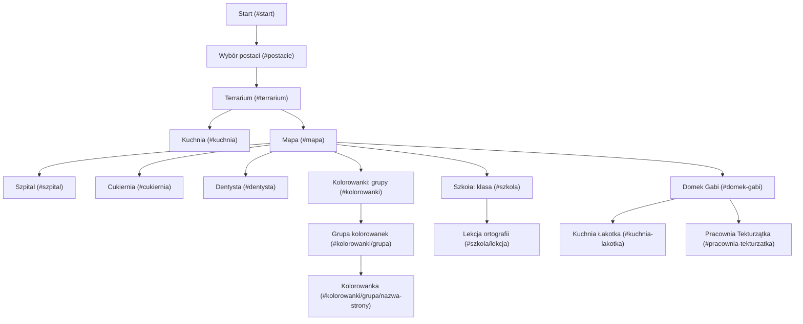

# Świat Sióstr

Gra w przeglądarce oparta na [Phaser 4](https://phaser.io) (ładowanym z CDN, bez kroku budowania).

## Uruchomienie

Potrzebny jest Node.js (bez dodatkowych pakietów).

```bash
npm start
```

Następnie otwórz http://localhost:8080. Serwer ([tools/dev-server.mjs](tools/dev-server.mjs)) wyłącza cache, więc przycisk przeładowania w prawym górnym rogu gry zawsze wczytuje najnowsze pliki. `npm run dev` włącza auto-przeładowanie (serwer sam odświeża podłączone przeglądarki po każdej zmianie pliku), ale na co dzień go nie używamy. Na innym urządzeniu w tej samej sieci Wi-Fi (np. iPad) otwórz `http://<IP komputera>:8080`.

## Instalacja jako aplikacja

Gra ma manifest (`docs/manifest.webmanifest`), service worker (`docs/sw.js`) i ikony (`docs/assets/icons/`, generowane przez `node tools/make-icons.mjs`). Chrome proponuje „Zainstaluj aplikację” tylko dla stron z HTTPS albo z `localhost`. Żeby zainstalować grę z telefonu w sieci domowej, w Chrome na Androidzie otwórz `chrome://flags`, w opcji **Insecure origins treated as secure** wpisz `http://<IP komputera>:8080`, ustaw **Enabled** i uruchom Chrome ponownie.

## GitHub Pages

Workflow `.github/workflows/pages.yml` publikuje grę z folderu `docs/` na gałęzi `main` przy każdym pushu. Przy okazji dopisuje plik `version.json` z SHA commita i datą builda, które widać na dole okna Ustawień. Na stronę trafia tylko ten folder, w którym są wszystkie pliki gry. Notatki, skany rysunków (`assets/scans/`) i narzędzia (`tools/`) leżą poza nim, więc zostają poza stroną. Muzyka z `docs/assets/music/` jest w repozytorium, więc trafia też na stronę. Jeśli żadnego pliku piosenki nie ma, gra ukrywa przycisk nutki.

Jednorazowo w ustawieniach repozytorium: **Settings → Pages → Build and deployment → Source: GitHub Actions**.

## Ekrany

Strzałki pokazują, dokąd można przejść z danego ekranu. Z każdego ekranu niżej przycisk powrotu prowadzi o poziom wyżej. W nawiasach jest adres ekranu po `#`.



Z mapy da się też pójść z powrotem do domu, czyli do terrarium. Zębatka Ustawień jest na każdym ekranie. Strzałka w lewo przyspiesza animacje, np. powrót postaci do domu na mapie. Przycisk przeładowania w prawym górnym rogu zawsze wraca na Start.

## Struktura

- `docs/` – cała gra, publikowana na GitHub Pages
  - `index.html` – strona gry, ładuje Phaser i skrypty
  - `src/main.js` – konfiguracja `Phaser.Game`, importuje resztę kodu (moduły ES)
  - `src/scenes/` – ekrany gry (start, postacie, terrarium, mapa, szpital, kuchnia), `terrarium/` – części terrarium
  - `src/ui/`, `src/gfx/`, `src/audio/` – wspólne elementy interfejsu, grafika i dźwięk
  - `src/data/` – postacie i lista muzyki
  - `assets/icons/` – ikony aplikacji, `assets/music/` – muzyka (tylko lokalnie)
- `tools/` – serwer deweloperski, generator ikon, `check.mjs` (`npm run check`: szybka kontrola kodu i danych) i `add-song.mjs` (dodawanie piosenki z YouTube)
- `assets/scans/` – skany rysunków postaci (nie trafiają na stronę)
- `assets/fonts/leggie/` – czcionka Leggie w formacie BDF. `node tools/make-pixel-font.mjs` robi z niej obrazki liter dla gry w `docs/assets/fonts/`.

## Czcionka

Tekst w grze jest pisany czcionką bitmapową [Leggie](https://github.com/wikkyk/leggie), Copyright 2012–2018 Wiktor Kerr, na licencji [Creative Commons Uznanie autorstwa 4.0 (CC BY 4.0)](https://creativecommons.org/licenses/by/4.0/). Pełny tekst licencji jest w `assets/fonts/leggie/LICENCE`. Gra używa rozmiarów 12, 18 i 24 px, zwykłych i pogrubionych, zamienionych na obrazki PNG. Kształty liter się nie zmieniają: gra tylko je koloruje, dodaje obrys i cień oraz powiększa o pełną liczbę razy.
